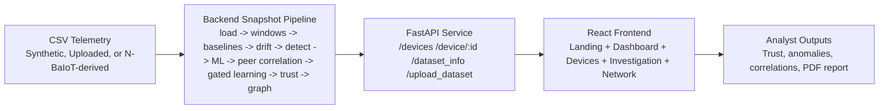

# Phantom Nexus

Phantom Nexus is a full-stack cybersecurity prototype for early detection of IoT botnet recruitment from network telemetry. The system ingests CSV telemetry, builds per-device behavior baselines, detects drift and suspicious recruitment patterns, scores trust, correlates peers, gates adaptive learning, and exposes the results through a SOC-style investigation dashboard.

The current prototype is built for demo and exploration rather than offline model training or production deployment. It favors explainable signals, fast dataset refresh, and device-level investigation workflows.

## What The Current Prototype Does

Phantom Nexus answers these practical questions for each monitored IoT device:

1. What does normal behavior look like for this device?
2. Is the device drifting away from its baseline?
3. Are there signs of early botnet recruitment such as beaconing, unusual ports, or external outreach?
4. How risky is the device right now, and what trust score should it receive?
5. Are nearby devices showing coordinated suspicious behavior?
6. Should adaptive baseline learning stay enabled or be frozen?
7. How can an analyst export the findings into a report?

## Core Capabilities

- CSV telemetry ingestion and validation
- Drag-and-drop dataset upload from the frontend
- Feature engineering over per-device behavior and rolling windows
- Phantom Twin baseline modeling and digital twin views
- Drift detection using change-point analysis
- Hybrid botnet detection using both heuristics and an ML classifier
- Trust score computation on a 0-100 scale
- Peer correlation detection for coordinated suspicious activity
- Gated learning controls to freeze or roll back baseline updates
- Graph-based risk visualization across connected devices
- Device investigation views with LLM-assisted summaries
- Downloadable PDF investigation reports
- Live device monitoring with Windows raw-socket packet capture, real-time trust scoring, and telemetry CSV export

## High-Level Architecture



## Backend Workflow

Whenever the active dataset changes, the backend rebuilds a fresh snapshot.

1. Load telemetry rows from the active CSV.
2. Validate required columns and normalize timestamp and numeric fields.
3. Aggregate flows into per-device time windows.
4. Build device behavioral baselines and digital twin context.
5. Detect behavioral drift using change-point analysis.
6. Run heuristic botnet detection over recent behavior.
7. Engineer device-level ML features and train a per-snapshot RandomForest classifier.
8. Merge heuristic and ML detections into a single device verdict.
9. Compute trust scores and trust histories.
10. Detect peer correlations and evaluate gated learning decisions.
11. Build the internal risk graph.
12. Generate explainability payloads, investigation data, and report content for the frontend.

## Current Backend Modules

### `backend/app/data_loader.py`

- Resolves the active dataset source.
- Validates telemetry schema.
- Normalizes timestamps and numeric columns.
- Supports synthetic, N-BaIoT-derived, and uploaded datasets.

### `backend/app/feature_engineering.py`

- Converts raw telemetry into time-windowed device features.
- Produces the rolling signals used for baselines, drift, and trust.

### `backend/app/phantom_twin.py`

- Builds per-device behavioral baselines.
- Produces digital twin views that compare observed behavior to expected behavior.

### `backend/app/drift_detection.py`

- Uses Ruptures to identify change points and drift severity.

### `backend/app/botnet_detector.py`

- Detects suspicious recruitment indicators such as:
  - new external IPs
  - suspicious ports
  - periodic beaconing
  - DNS anomalies
  - external outreach spikes

### `backend/app/ml_model.py`

- Engineers device-level behavioral features such as connection frequency, port entropy, beacon timing variance, and external IP diversity.
- Trains a snapshot-local `RandomForestClassifier`.
- Produces botnet probability and anomaly summary per device.

### `backend/app/peer_correlation.py`

- Finds coordinated suspicious behavior across devices.
- Produces correlation scores and correlated peer lists.

### `backend/app/gated_learning.py`

- Decides whether baseline learning should remain adaptive or be frozen.
- Uses trust score, active anomalies, peer correlation, and shadow-model divergence as gating signals.

### `backend/app/trust_engine.py`

- Computes trust score history, device status, and risk level.

### `backend/app/risk_graph.py`

- Builds a NetworkX graph of device relationships.
- Propagates local risk pressure across neighboring devices.

### `backend/app/explainability.py`

- Produces structured analyst-facing explanations.

### `backend/app/llm_explainer.py`

- Generates SOC-style security summaries using Groq when available.
- Falls back to a local heuristic summary if the LLM call fails.

### `backend/app/pdf_report_generator.py`

- Creates a PDF investigation report for a device using ReportLab.

### `backend/app/live_monitor.py`

- Implements the live IPv4 packet capture engine using Windows raw sockets (`socket.AF_INET, socket.SOCK_RAW, socket.IPPROTO_IP`).
- Manages monitoring session state (start, stop, status query, active session locking).
- Detects Windows Administrator privileges using `ctypes.windll.shell32.IsUserAnAdmin()`.
- Enumerates available network adapters and automatically binds to the interface matching the target device route.
- Handles Wi-Fi promiscuous mode restrictions (`SIO_RCVALL`) gracefully with fallback to host raw-socket capture.
- Extracts 8-column network telemetry (`device_id`, `timestamp`, `src_ip`, `dest_ip`, `dest_port`, `protocol`, `bytes`, `packets`) adhering to the project's data schema.
- Computes real-time traffic statistics, time-series throughput buckets, protocol and destination port distributions, beaconing variance, and live trust score deductions.
- Formats and exports captured session flows as downloadable CSV datasets.

### `backend/app/main.py`

- Orchestrates the full snapshot rebuild.
- Exposes the REST API, including live device monitoring endpoints.
- Handles CSV uploads and device report downloads.

## Frontend Workflow

The frontend presents the backend snapshot and live capture capabilities through five main command views plus a landing page:

1. Landing page introduces the product and links into the command views.
2. Dashboard shows fleet posture, trust trajectory, risk distribution, and the network graph.
3. Devices page shows the active dataset, supports CSV upload, and lists the fleet.
4. Device Investigation page shows trust gauge, anomaly breakdown, peer correlations, gated learning state, LLM narrative, and PDF export.
5. Network Map shows the graph-oriented view of device relationships and propagation context.
6. Live Monitoring page provides real-time device traffic capture, adapter diagnostics, target verification, throughput charts, and session CSV export.

The current UI ships as a dark command-center style interface. The earlier light/dark theme toggle is no longer part of the present prototype.

## Current Frontend Modules

### `frontend/src/App.jsx`

- Defines the routes:
  - `/`
  - `/dashboard`
  - `/devices`
  - `/devices/:deviceId`
  - `/network`
  - `/live-monitoring`

### `frontend/src/components/Navbar.jsx`

- Top navigation for the landing, dashboard, devices, network, and live monitoring views.

### `frontend/src/components/FileUpload.jsx`

- Drag-and-drop CSV upload with progress tracking.
- Calls the backend upload API and refreshes the dataset snapshot.

### `frontend/src/components/DeviceTable.jsx`

- Fleet watchlist table for device trust and anomaly posture.

### `frontend/src/components/TrustScoreChart.jsx`

- Recharts-based trust history visualization.

### `frontend/src/components/NetworkGraph.jsx`

- React Flow graph for network and propagation context.

### `frontend/src/pages/Landing.jsx`

- Product entry page and feature overview.

### `frontend/src/pages/Dashboard.jsx`

- Fleet overview, aggregate trust trend, risk distribution, priority queue, and graph preview.

### `frontend/src/pages/Devices.jsx`

- Device fleet view plus active dataset metadata and upload controls.

### `frontend/src/pages/DeviceInvestigation.jsx`

- Deep investigation page for one device.
- Includes anomaly chart, peer correlations, learning state, LLM explanation, and PDF report download.

### `frontend/src/pages/NetworkMap.jsx`

- Dedicated graph-centric visualization page.

### `frontend/src/pages/LiveMonitoring.jsx`

- Real-time device monitoring interface with backend PID and Administrator elevation badge.
- Target IPv4 address selection with one-click detected network adapter chips.
- Session controls: Start Monitoring, Stop Monitoring, and Download Captured CSV.
- Live metric counters: capture duration, total interface packets, verified target packets, and real-time trust score.
- Recharts-powered Live Packet Throughput time-series chart and protocol/port breakdown badges.
- Live Observed Connections table displaying recent flows and timestamps.
- Diagnostic banner explaining elevation requirements, adapter visibility, and Windows raw-socket loopback behavior.

### `frontend/src/services/api.js`

- Central frontend API wrapper, including endpoints for dataset analysis, device investigation, and live monitoring session management.

## REST API

The backend currently exposes these endpoints:

- `GET /`
- `GET /devices`
- `GET /trust_scores`
- `GET /drift`
- `GET /risk_graph`
- `GET /digital_twins`
- `GET /peer_correlations`
- `GET /dataset_info`
- `GET /device/{device_id}`
- `POST /upload_dataset`
- `GET /device_investigation/{device_id}`
- `GET /device_report/{device_id}`
- `POST /live_monitoring/start`
- `POST /live_monitoring/stop`
- `GET /live_monitoring/status`
- `GET /live_monitoring/sessions`
- `GET /live_monitoring/diagnostics`
- `GET /live_monitoring/export/{session_id}`

## Data Model

### Required Input Columns

- `device_id`
- `timestamp`
- `src_ip`
- `dest_ip`
- `dest_port`
- `protocol`
- `bytes`
- `packets`

### ML Feature Set

The current ML model uses 10 engineered device-level features:

- `connection_frequency`
- `unique_dest_ips`
- `avg_bytes`
- `avg_packets`
- `port_entropy`
- `time_of_day_activity`
- `beacon_interval_std`
- `external_ip_diversity`
- `suspicious_port_ratio`
- `off_hours_activity`

### Primary Device Outputs

- trust score
- risk level
- drift score
- botnet probability
- anomaly score
- anomaly list
- peer correlation score
- gated learning state
- LLM explanation
- PDF investigation report

## Detection and ML Design

Phantom Nexus currently uses a hybrid detection design:

- Heuristics identify explicit suspicious patterns such as beaconing, suspicious ports, and new external destinations.
- A `RandomForestClassifier` adds a behavior-based probability score using engineered device-level features.
- The final device verdict merges the heuristic and ML outputs.

The model is trained per snapshot rather than as a long-lived pre-trained artifact. This keeps the prototype responsive to uploaded datasets and demo refreshes.

## Dataset Support

No dataset CSV files are committed to this repository. You must either generate the synthetic demo dataset locally or download and preprocess the N-BaIoT dataset before running the backend.

### 1. Synthetic Demo Dataset

Default source: `backend/dataset/iot_sample.csv`

Generated by:

- `backend/scripts/generate_demo_dataset.py`

This dataset is designed to surface demo-worthy incidents in the latest windows.

### 2. Uploaded CSV Datasets

- Uploaded through the Devices page.
- Stored under `backend/dataset/uploads/`.
- Automatically validated and used as the new active dataset.

### 3. N-BaIoT-Derived Dataset

Optional source: `backend/dataset/iot_sample_n_baiot.csv`

Generated from the raw N-BaIoT data using:

- `backend/scripts/preprocess_n_baiot.py`

The preprocessing script maps the source data into the backend telemetry schema and injects late suspicious windows so the prototype remains visually useful during demos.

The raw dataset is not stored in this repository. Download it yourself before preprocessing.

## Project Structure

```text
MahaDEVS_Phantom-Nexus/
├── backend/
│   ├── app/
│   │   ├── __init__.py
│   │   ├── botnet_detector.py
│   │   ├── data_loader.py
│   │   ├── drift_detection.py
│   │   ├── explainability.py
│   │   ├── feature_engineering.py
│   │   ├── gated_learning.py
│   │   ├── live_monitor.py
│   │   ├── llm_explainer.py
│   │   ├── main.py
│   │   ├── ml_model.py
│   │   ├── pdf_report_generator.py
│   │   ├── peer_correlation.py
│   │   ├── phantom_twin.py
│   │   ├── risk_graph.py
│   │   └── trust_engine.py
│   ├── dataset/
│   │   ├── iot_sample.csv
│   │   ├── iot_sample_n_baiot.csv
│   │   └── uploads/
│   ├── scripts/
│   │   ├── generate_demo_dataset.py
│   │   └── preprocess_n_baiot.py
│   └── requirements.txt
├── datasets/
│   └── n-baiot/
├── frontend/
│   ├── public/
│   ├── src/
│   │   ├── components/
│   │   ├── pages/
│   │   ├── services/
│   │   ├── App.jsx
│   │   ├── index.css
│   │   └── main.jsx
│   ├── index.html
│   ├── package.json
│   ├── postcss.config.js
│   ├── tailwind.config.js
│   └── vite.config.js
├── start.ps1
├── test_groq.py
└── README.md
```

## Tech Stack

### Backend

| Technology | Used For |
|---|---|
| Python | Backend logic and analytics pipeline |
| FastAPI | REST API layer |
| Pandas | CSV loading and feature aggregation |
| NumPy | Numerical scoring helpers |
| scikit-learn | RandomForest-based device classifier |
| Ruptures | Drift detection |
| NetworkX | Device relationship graph |
| ReportLab | PDF report generation |
| Groq | Optional LLM-generated investigation summaries |
| Uvicorn | ASGI development server |

### Frontend

| Technology | Used For |
|---|---|
| React | UI composition |
| Vite | Development and build pipeline |
| React Router | App routing |
| Tailwind CSS | Styling and layout |
| Bootstrap | Selective UI utility styling |
| Recharts | Charts |
| React Flow (`@xyflow/react`) | Network visualization |
| `react-dropzone` | Drag-and-drop dataset upload |

## Getting Started

### Prerequisites

- Python 3.10 or higher
- Node.js 18 or higher
- npm

### 1. Clone the repository

```powershell
git clone https://github.com/PriyankaB-11/Eclipse_MahaDEVS_PhantomNexus.git
cd Eclipse_MahaDEVS_PhantomNexus
```

### 2. Create and activate a virtual environment

```powershell
python -m venv .venv
.venv\Scripts\Activate.ps1
```

### 3. Install backend dependencies

```powershell
cd backend
pip install -r requirements.txt
cd ..
```

### 4. Install frontend dependencies

```powershell
cd frontend
npm install
cd ..
```

### 5. Choose and prepare a dataset

The project does not ship with dataset CSVs. Pick one of these setup paths before starting the backend.

#### Option A: Generate the synthetic demo dataset locally

```powershell
cd backend
python scripts/generate_demo_dataset.py
cd ..
```

This creates `backend/dataset/iot_sample.csv` and is the fastest way to run the prototype.

#### Option B: Download and preprocess the N-BaIoT dataset

1. Download the raw N-BaIoT dataset from the UCI repository.
2. Extract the files into `datasets/n-baiot/`.
3. Run the preprocessor:

```powershell
python backend/scripts/preprocess_n_baiot.py
```

This creates `backend/dataset/iot_sample_n_baiot.csv`.

### 6. Start the application

You can either launch both services with the helper script or run them separately.

#### Option A: Use the helper script

```powershell
.\start.ps1
```

By default, `start.ps1` checks for port 8000 conflicts and launches the backend PowerShell window with Administrator privileges (`-Verb RunAs`). Windows will display a User Account Control (UAC) prompt for elevation, which is required for raw-socket live device packet monitoring. If you prefer standard user privileges, run `.\start.ps1 -NoAdmin`.

This opens:

- Backend: `http://127.0.0.1:8000`
- Frontend: `http://localhost:5173`

#### Option B: Run services manually

Backend (open PowerShell **as Administrator** to enable Live Device Monitoring):

```powershell
cd backend
$env:PHANTOM_DATA_SOURCE = "synthetic"
uvicorn app.main:app --reload --host 127.0.0.1 --port 8000
```

If you prepared the N-BaIoT dataset instead, switch the source before starting the backend:

```powershell
cd backend
$env:PHANTOM_DATA_SOURCE = "n_baiot"
uvicorn app.main:app --reload --host 127.0.0.1 --port 8000
```

Frontend:

```powershell
cd frontend
npm run dev
```

## Frontend Pages

| Page | Route | Purpose |
|---|---|---|
| Landing | `/` | Product entry point and overview |
| Dashboard | `/dashboard` | Fleet metrics, trust trend, risk distribution, graph preview |
| Devices | `/devices` | Device list, active dataset metadata, CSV upload |
| Device Investigation | `/devices/:deviceId` | Deep dive into one device |
| Network Map | `/network` | Graph-oriented relationship view |
| Live Monitoring | `/live-monitoring` | Real-time packet capture, target verification, live throughput charts, and telemetry CSV export |

## Live Device Monitoring

Live Device Monitoring enables real-time IPv4 packet capture, traffic analysis, and telemetry collection directly from the physical network adapter on Windows hosts without requiring third-party packet drivers (like WinPcap or Npcap).

### Architecture & Key Capabilities

- **Native Windows Raw Sockets**: Uses Python's native `socket(AF_INET, SOCK_RAW, IPPROTO_IP)` to capture incoming and outgoing IPv4 packets directly from the operating system's network stack.
- **Dynamic Interface Routing**: Automatically discovers active network adapters via `get_available_interfaces()` and binds capture to the local interface corresponding to the target device's IP route.
- **Target-Specific Packet Verification**: Strictly distinguishes between **Total Interface Packets** (all raw packets passing the adapter) and **Verified Target Packets** (`src_ip == target_ip` or `dest_ip == target_ip`). A monitoring session only reports target activity once real packets matching the target IPv4 address are observed and decoded.
- **Telemetry Extraction Schema**: Parses IPv4 headers and transport layers (TCP, UDP, ICMP) into the 8 standard columns required by Phantom Nexus:
  - `device_id` (e.g. `live_10_57_150_11`)
  - `timestamp` (ISO 8601 UTC)
  - `src_ip`
  - `dest_ip`
  - `dest_port`
  - `protocol` (TCP, UDP, ICMP)
  - `bytes`
  - `packets` (fixed at 1 per flow entry)
- **Live Behavioral Analytics**:
  - **Packet Throughput Time Series**: Aggregates throughput into rolling time buckets for Recharts time-series visualization.
  - **Protocol & Port Distribution**: Tracks real-time frequency distribution across transport protocols and destination ports.
  - **Suspicious Port Indicators**: Flags known botnet recruitment and attack ports (e.g. 23/Telnet, 37215, 52869, 4444).
  - **Beaconing Pattern Analysis**: Calculates variance in inter-arrival timestamps across target packets to detect periodic C2 beaconing.
  - **Dynamic Trust Score**: Computes an instantaneous trust score (0–100 scale) with deductions for suspicious ports (-20 per port), periodic beaconing (-30), and elevated external IP fanout (-15).
- **Session Lifecycle & Export**: Supports starting, stopping, real-time status polling (frontend polls `GET /live_monitoring/status` every 1.5 seconds), and exporting sessions as downloadable CSV datasets.

### Usage Instructions (Step-by-Step)

#### 1. Start Phantom Nexus with Elevation
Because Windows raw sockets require administrative privileges, start the system using one of the elevated startup methods:
- **Helper Script**: Run `.\start.ps1` in PowerShell. Accept the UAC prompt to launch the backend with Administrator privileges (`-Verb RunAs`).
- **Manual Start**: Open **PowerShell as Administrator**, navigate to `backend`, and run:
  ```powershell
  Set-Location 'backend'
  uvicorn app.main:app --reload --host 127.0.0.1 --port 8000
  ```
  In a separate standard terminal, start the frontend:
  ```powershell
  Set-Location 'frontend'
  npm run dev
  ```

#### 2. Open Live Monitoring
Open your web browser and navigate to `http://localhost:5173/live-monitoring` (or click **Live Monitoring** in the navigation bar).

#### 3. Verify Elevation Status
Check the status badge in the header:
- **`PID <number> • Administrator Active` (Emerald Green)**: The backend process possesses administrative privileges and raw sockets are ready.
- **`Non-Elevated (PID <number>)` (Amber / Red)**: The backend was launched without administrative privileges or an older un-elevated Uvicorn instance is still holding port 8000 (see [Troubleshooting](#troubleshooting-live-monitoring)).

#### 4. Select Target IPv4 Address
- Click the detected interface quick-chip (e.g. `🎯 Target 10.57.150.11`) to target your active network adapter, or manually type an active IPv4 address on your local subnet.
- Click **Start Monitoring** (`POST /live_monitoring/start`).
- The engine transitions to `Capturing Active Traffic`, with the verification state showing `Awaiting Initial Target Traffic`.

#### 5. Generate Network Traffic to Verify Capture
To test packet capture against your target interface (e.g., `10.57.150.11`), generate real network traffic in another terminal window:
```powershell
# Generate HTTP traffic to the physical adapter IP:
curl.exe http://10.57.150.11:8000/live_monitoring/diagnostics

# Or generate ICMP traffic:
ping.exe 10.57.150.11 -n 5
```
> [!IMPORTANT]
> **Do not send test traffic to `127.0.0.1` / `localhost`**. Windows raw sockets only observe physical network adapter traffic and cannot intercept loopback traffic handled entirely within the OS loopback driver.

#### 6. Observe Real-Time Telemetry and Verification
- The frontend automatically polls `GET /live_monitoring/status` every 1.5 seconds while monitoring is active.
- **Verified Target Packets** increments in real time.
- The **Verification Status** badge transitions from `Awaiting Initial Target Traffic` to `Target Activity Verified (Real Traffic Captured)`.
- The **Live Packet Throughput** chart plots the incoming packet and byte rates.
- The **Live Observed Connections** table logs source/destination IP pairs, ports, protocols, and byte counts.
- Detected anomalies and the live **Trust Score** update dynamically based on observed traffic behavior.

#### 7. Stop and Export Session CSV
- Click **Stop Monitoring** (`POST /live_monitoring/stop`).
- Click **Download Captured CSV** (`GET /live_monitoring/export/{session_id}`).
- The exported CSV file contains the verified flows formatted with the standard 8 columns:
  ```csv
  device_id,timestamp,src_ip,dest_ip,dest_port,protocol,bytes,packets
  live_10_57_150_11,2026-10-11T11:06:15Z,10.57.150.11,10.57.150.11,8000,TCP,52,1
  ```

---

### Windows Permissions and Network Limitations

#### 1. Administrator Privileges Requirement
Windows raw sockets (`SOCK_RAW`) require Administrator rights under Windows security policy. If launched as a standard user, raw socket initialization fails with `WSAEACCES (10013)` or `PermissionError`. The backend detects elevation via `ctypes.windll.shell32.IsUserAnAdmin()`.

#### 2. Wi-Fi Driver `SIO_RCVALL` Behavior & Fallback
On many Windows Wi-Fi cards (such as Realtek 8851BE or Intel wireless adapters), calling `raw_socket.ioctl(socket.SIO_RCVALL, socket.RCVALL_ON)` for promiscuous mode fails with `[WinError 10013]` (`WSAEACCES`) or `[WinError 10022]` (`WSAEINVAL`) because wireless NDIS miniport drivers typically restrict promiscuous packet inspection.
- Phantom Nexus handles this gracefully: if `SIO_RCVALL` is rejected by the driver, the engine **does not abort**. Instead, it logs a warning and falls back to **standard host raw mode** (`RUNNING_STANDARD_PRIVILEGES`), capturing all packets destined to or originating from the local host adapter.

#### 3. Network Visibility on Switched Wi-Fi and Phone Hotspots
- When a laptop is connected to a mobile phone hotspot or standard Wi-Fi network, 802.11 client isolation and switched unicast routing prevent the laptop from passively sniffing another phone's or IoT device's direct internet traffic.
- The laptop can only observe:
  1. Traffic sent directly to or from the laptop's own IP address.
  2. Broadcast packets (e.g., ARP, DHCP) and multicast traffic (e.g., mDNS, SSDP).
- **Target Verification Principle**: A target packet count of zero **does not indicate that a device is safe or clean**; it simply means no traffic matching that IP address was visible to the laptop's adapter. The system will never claim successful target monitoring until matching packets are captured and verified.

#### 4. Localhost Loopback Traffic Invisibility
Windows raw sockets cannot capture packets addressed to `127.0.0.1` / `localhost`. All loopback communication stays within the Windows loopback virtual adapter and bypasses physical network interface sockets. When testing packet capture, always target the machine's actual LAN/Wi-Fi IPv4 address (e.g. `10.57.150.11`).

#### 5. Troubleshooting Live Monitoring

| Symptom | Cause | Solution |
|---|---|---|
| **"Administrator Privileges Required" badge persists** | An un-elevated Uvicorn instance is holding port 8000 from an earlier run. | Check port 8000 using `Get-NetTCPConnection -LocalPort 8000 \| Select-Object OwningProcess`. Terminate the un-elevated PID (`Stop-Process -Id <PID> -Force`), then re-run `.\start.ps1`. |
| **Packet counter stays at 0** | Test traffic was sent to `127.0.0.1` instead of the physical interface IP, or target device is not communicating with host. | Send test traffic to the detected adapter IP (e.g., `curl.exe http://10.57.150.11:8000/live_monitoring/diagnostics`). |
| **Promiscuous mode warning in logs** | Wi-Fi adapter driver rejected `SIO_RCVALL`. | Normal behavior on wireless adapters. The system automatically falls back to host raw mode. |
| **Session cannot start** | An existing session is already running. | Click **Stop Monitoring** on the active session before starting a new one. |

---

### Relationship to the Digital Twin

Live Device Monitoring provides **real-time observable telemetry collection and anomaly tracking** for an active device. It does **not** automatically mutate or synchronize the synthetic/offline Digital Twin model in real time.

Instead, the live monitoring engine bridges into the full Phantom Nexus offline intelligence pipeline through standard telemetry export:

1. The exported CSV file strictly adheres to the 8 required columns (`device_id, timestamp, src_ip, dest_ip, dest_port, protocol, bytes, packets`) enforced by `backend/app/data_loader.py`.
2. Analysts can download the captured session CSV and immediately upload it via the **Dataset Upload** interface on the **Devices** page (`/devices`).
3. Upon upload, Phantom Nexus executes its full analytical workflow over the captured live traffic:
   - Rolling time-window feature aggregation.
   - Phantom Twin behavioral baseline construction.
   - Ruptures-based change-point drift detection.
   - Per-snapshot RandomForest botnet classifier training and scoring.
   - Peer correlation analysis across devices.
   - Gated learning stability evaluation.
   - Risk graph propagation and visualization.
   - Downloadable PDF investigation report generation.

## Environment Variables

| Variable | Default | Description |
|---|---|---|
| `PHANTOM_DATA_SOURCE` | `synthetic` | Dataset source: `synthetic` or `n_baiot` |
| `VITE_API_BASE_URL` | `http://127.0.0.1:8000` | Frontend API base URL |
| `GROQ_API_KEY` | unset in recommended setup | Optional Groq key for LLM summaries |

If `GROQ_API_KEY` is not set, the backend falls back to a local heuristic summary generator.

Example:

```powershell
$env:PHANTOM_DATA_SOURCE = "n_baiot"
cd backend
uvicorn app.main:app --reload
```

## N-BaIoT Workflow

If you want to run the prototype on the N-BaIoT dataset:

1. Download the raw dataset from the UCI repository.
2. Extract it into `datasets/n-baiot/`.
3. Run the preprocessor.
4. Start the backend with `PHANTOM_DATA_SOURCE=n_baiot`.

The downloaded raw dataset stays local and should not be committed.

Preprocessing command:

```powershell
python backend/scripts/preprocess_n_baiot.py
```

This generates `backend/dataset/iot_sample_n_baiot.csv`.

## Current Limitations

- The primary workflow is snapshot-based, not streaming.
- The ML model is intentionally lightweight and retrained per snapshot.
- Uploaded datasets must match the required telemetry schema.
- The prototype is optimized for explainability and demo flow rather than production-scale model management.
- Groq summaries are best treated as optional enrichment; the backend can fall back to heuristic narrative generation.
- **Live Device Monitoring**:
  - Live packet capture relies on Windows raw sockets (`SOCK_RAW`), which require Administrator privileges.
  - Windows raw sockets cannot observe loopback (`127.0.0.1`) traffic; test traffic must be directed to physical network adapter IPs.
  - On standard Wi-Fi networks and phone hotspots, client isolation and wireless driver restrictions limit promiscuous packet capture (`SIO_RCVALL`) to traffic addressed to or originated by the local host.
  - Live device monitoring tracks real-time heuristic metrics and trust deductions; it does not automatically update or mutate the offline Digital Twin model in real time without exporting and uploading the session CSV.

## Summary

Phantom Nexus currently combines telemetry ingestion, behavioral baselining, drift detection, hybrid botnet scoring, trust analytics, peer correlation, gated learning, graph context, device investigation, LLM-assisted explanation, PDF export, and live device packet capture into a single demo-ready security prototype.
